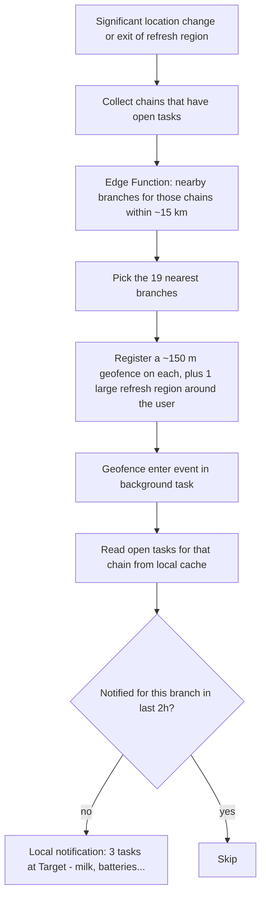

# Location-Based Task Reminder App

## Stack
- **App:** React Native with Expo (TypeScript), Expo Router for navigation, built as an Expo development build. Expo Go can't run background location, so it won't work for this.
- **Location:** `expo-location` handles geofencing and significant-change updates. `expo-task-manager` runs that code in the background.
- **Notifications:** `expo-notifications` shows **local** notifications. The geofence fires on the phone itself, so no push server is needed. The user still sees a normal notification banner.
- **Backend:** Supabase provides authentication (email magic link or Apple/Google sign-in), Postgres with row-level security, and Edge Functions.
- **Store lookup:** Google Places API (New) Text Search, called through a Supabase Edge Function so the API key stays off the device.
- **Builds:** EAS Build for both platforms. To install on the iPhone you'll need an Apple Developer account ($99/year), then distribute through TestFlight or an ad-hoc build. On the Pixel you can install the APK directly.

## How chain-based reminders work
The hard limit is that iOS lets an app monitor at most **20 geofences** at a time; Android allows 100. Since there can be hundreds of Target stores, the app can't watch all of them. Instead it keeps re-registering the geofences for the branches closest to you:

- The "refresh region" is a geofence with a radius of about 5 km centered on you. When you leave it, the background task runs again and re-registers the geofences. Together with significant-change updates, this keeps the 19 branch geofences close to wherever you are.
- Tasks and branches are cached on the device with `expo-sqlite`, so the background task works without a network connection. A per-branch cooldown prevents repeated notifications.

## Data model (Supabase)
- `chains`: `id`, `name` (for example "Target"), `places_query`, `brand_match` (the name pattern used to filter Places results).
- `tasks`: `id`, `user_id`, `chain_id`, `title`, `notes`, `done`, `created_at`. Row-level security limits each user to their own rows.
- `branch_cache`: `place_id`, `chain_id`, `lat`, `lng`, `name`, `fetched_at`. This is shared and keeps Places API costs down.
- Edge Function `nearby-branches(lat, lng, chain_ids[])` returns cached branches and fills any gaps from Google Places.

## App structure
- `app/(auth)/sign-in.tsx`: sign-in screen.
- `app/(tabs)/index.tsx`: task list grouped by chain, with a "near you" badge.
- `app/task/[id].tsx` and `app/task/new.tsx`: create and edit tasks. The chain picker searches existing chains or creates a new one.
- `app/settings.tsx`: permission status, notification test, and the cooldown setting.
- `src/lib/supabase.ts`, `src/lib/db.ts` (local SQLite cache and sync).
- `src/location/geofenceTask.ts`: the background task definitions and the refresh algorithm above.
- `src/location/permissions.ts`: a staged permission flow. It asks for foreground location, then "Always"/background location, then notifications, explaining each step.
- `app.config.ts`: iOS `NSLocationAlwaysAndWhenInUseUsageDescription`, `UIBackgroundModes: [location]`; Android `ACCESS_BACKGROUND_LOCATION` and `POST_NOTIFICATIONS`.

## Platform caveats
- iOS only delivers geofence events if the user grants "Always" location access. Android needs "Allow all the time", and the Pixel's battery optimization can delay events by a minute or two.
- If the user force-quits the app on iOS, geofence events still relaunch it. Android does the same unless the app is force-stopped from settings.
- A ~150 m radius is about as small as is reliable. Accuracy is typically 50 to 200 m.

## Local development on Windows
- **Android Emulator (primary):** Install Android Studio and create a Pixel virtual device from a "Google Play" system image (needed for Play Services geofencing). Run `npx expo run:android` to build and install the dev build; after that, `npx expo start` hot-reloads code changes.
- **Faking location:** Use the emulator's Extended Controls > Location to drop a pin on a store or play back a GPX/KML route that drives past one. You can also run `adb emu geo fix <lng> <lat>` from a script.
- **Dev-only "Simulate arrival" button** in `app/settings.tsx`: calls the geofence enter handler directly for a chosen branch, so you can test notification logic instantly without waiting on real geofence events.
- **Backend:** Use a free hosted Supabase project (no Docker needed). Run Edge Functions locally with `supabase functions serve` if Docker is available, otherwise deploy them to the hosted project.
- **iOS:** The iOS Simulator only runs on macOS, so it isn't available on Windows. Do all day-to-day work on the Android Emulator, then test iOS on the real iPhone with an EAS dev build near the end.

## Out of scope for v1
- Task sharing between users.
- Specific single-location tasks. This can be added later as a "custom place" chain with one branch.
- App Store and Play Store publishing. v1 is for personal installs.